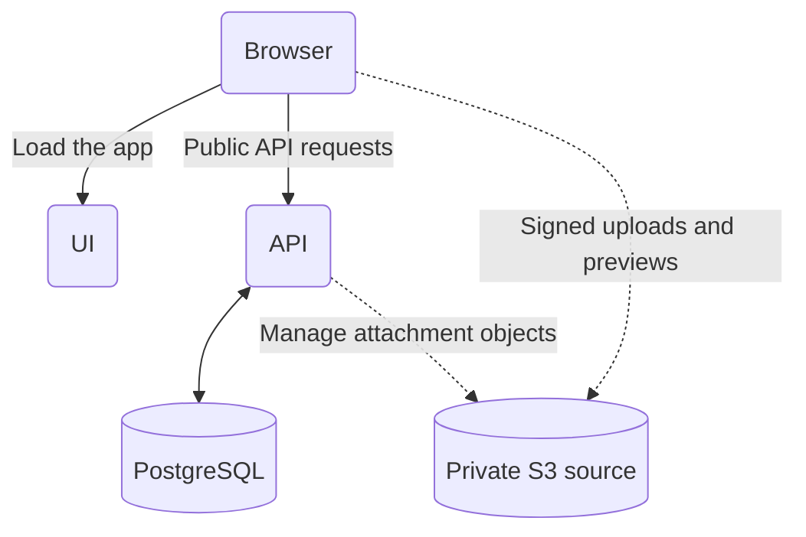

# Architecture overview

Mill runs an API and a UI connected to PostgreSQL. A private S3-compatible bucket is optional for task attachments.

| Component  | What it does                                                                                    |
| ---------- | ----------------------------------------------------------------------------------------------- |
| UI         | Serves the web application for boards, tasks, comments and team settings.                       |
| API        | Handles sign-in, permissions, task changes, attachments, REST and MCP clients.                  |
| PostgreSQL | Stores accounts, boards, tasks, comments, attachment metadata and client credentials.           |
| S3 source  | Stores uploaded images and PDFs in a private S3-compatible bucket when attachments are enabled. |

Only the UI and API need public HTTPS routes. Browsers call the API directly at its public origin. PostgreSQL stays private; the UI never receives database or storage credentials.

Each [Mill release](https://github.com/avgeek-oss/mill/releases) provides matching API and UI images for Linux AMD64 and ARM64. There is no separate worker or queue service to install.

## Choose an installation method

<CardGroup cols={2}>
  <Card title="Docker Compose" icon="/assets/installation/docker-compose.png" href="/installation/docker-compose">Run Mill with Docker Compose, using bundled PostgreSQL or your existing database.</Card>
  <Card title="Towbar" icon="/assets/installation/towbar.png" href="/installation/towbar">Deploy Mill through your Towbar installation with a connected Git repository and runtime settings.</Card>
</CardGroup>

<!-- installed-only:start -->

[Docker Compose guide](installation/docker-compose.md) · [Towbar guide](installation/towbar.md)

<!-- installed-only:end -->

After installation, create [your first board and task](boards.md). See [Configuration](configuration.md) for optional email and attachments, and set up [backups](backup.md) before storing production data.
