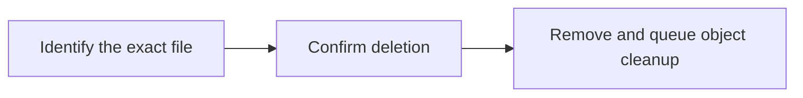

Remove a task attachment and queue its private file for permanent deletion. Confirm with the user before deleting their work.

## Workflow



## Access and behavior

Write or Administrator OAuth consent and a member/administrator team role are required. Tools are listed and callable only when the current grant and role permit them.

Removes the attachment immediately and queues private object deletion with durable retries. There is no attachment trash or restore endpoint.

<Warning>
  Confirm the exact target and consequence with the user before calling this
  tool.
</Warning>

## Arguments

| Argument         | Required | Type or meaning                                                                                            |
| ---------------- | -------- | ---------------------------------------------------------------------------------------------------------- |
| `taskId`         | Yes      | Task UUID, not its human identifier such as ENG-1.                                                         |
| `attachmentId`   | Yes      | uuid                                                                                                       |
| `idempotencyKey` | No       | One logical mutation key, reused unchanged on retries. MCP forwards it as the REST Idempotency-Key header. |

<Accordion title="Complete input schema">

```json
{
  "type": "object",
  "properties": {
    "taskId": {
      "type": "string",
      "format": "uuid",
      "pattern": "^([0-9a-fA-F]{8}-[0-9a-fA-F]{4}-[1-8][0-9a-fA-F]{3}-[89abAB][0-9a-fA-F]{3}-[0-9a-fA-F]{12}|00000000-0000-0000-0000-000000000000|ffffffff-ffff-ffff-ffff-ffffffffffff)$"
    },
    "attachmentId": {
      "type": "string",
      "format": "uuid",
      "pattern": "^([0-9a-fA-F]{8}-[0-9a-fA-F]{4}-[1-8][0-9a-fA-F]{3}-[89abAB][0-9a-fA-F]{3}-[0-9a-fA-F]{12}|00000000-0000-0000-0000-000000000000|ffffffff-ffff-ffff-ffff-ffffffffffff)$"
    },
    "idempotencyKey": {
      "type": "string",
      "minLength": 8,
      "maxLength": 128
    }
  },
  "required": ["taskId", "attachmentId"],
  "additionalProperties": false
}
```

</Accordion>

## Example call

The client initializes the MCP connection before sending this JSON-RPC call. Example records are fictional.

```json
{
  "jsonrpc": "2.0",
  "id": 1,
  "method": "tools/call",
  "params": {
    "name": "delete_attachment",
    "arguments": {
      "taskId": "22222222-2222-4222-8222-222222222222",
      "attachmentId": "44444444-4444-4444-8444-444444444444",
      "idempotencyKey": "restore-report-delete-001"
    }
  }
}
```

## Example result

Mill returns this object in `structuredContent` and normally a JSON text content block (large responses may shorten the text block). A tool failure sets `isError`; never treat an error as a completed mutation.

```json
{
  "ok": true
}
```

## Related reference

[HTTP operation](/api-reference/delete_api_tasks_by_taskId_attachments_by_attachmentId) · [Connect an MCP client](/mcp-connections) · [Request conventions](/api-reference/overview)
