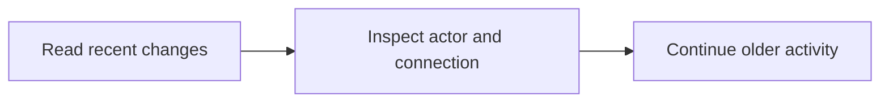

Read task and attachment activity, including who made each change. Comment and reply actions are not included.

## Workflow



## Access and behavior

A Read-only, Write or Administrator OAuth grant can call this tool within the user’s current team role. Tools are listed and callable only when the current grant and role permit them.

Task and attachment changes are recorded; comment and reply events are excluded, including historical comment rows. Activity identifies the responsible actor and, on new records, connection type and request ID.

## Arguments

| Argument | Required | Type or meaning                                                       |
| -------- | -------- | --------------------------------------------------------------------- |
| `taskId` | Yes      | Task UUID, not its human identifier such as ENG-1.                    |
| `limit`  | No       | integer                                                               |
| `cursor` | No       | Opaque nextCursor from the preceding response with identical filters. |

<Accordion title="Complete input schema">

```json
{
  "type": "object",
  "properties": {
    "taskId": {
      "type": "string",
      "format": "uuid",
      "pattern": "^([0-9a-fA-F]{8}-[0-9a-fA-F]{4}-[1-8][0-9a-fA-F]{3}-[89abAB][0-9a-fA-F]{3}-[0-9a-fA-F]{12}|00000000-0000-0000-0000-000000000000|ffffffff-ffff-ffff-ffff-ffffffffffff)$"
    },
    "limit": {
      "type": "integer",
      "minimum": 1,
      "maximum": 100
    },
    "cursor": {
      "type": "string",
      "maxLength": 2048
    }
  },
  "required": ["taskId"],
  "additionalProperties": false
}
```

</Accordion>

## Example call

The client initializes the MCP connection before sending this JSON-RPC call. Example records are fictional.

```json
{
  "jsonrpc": "2.0",
  "id": 1,
  "method": "tools/call",
  "params": {
    "name": "get_activity",
    "arguments": {
      "taskId": "22222222-2222-4222-8222-222222222222",
      "limit": 50
    }
  }
}
```

## Example result

Mill returns this object in `structuredContent` and normally a JSON text content block (large responses may shorten the text block). A tool failure sets `isError`; never treat an error as a completed mutation.

```json
{
  "items": [
    {
      "id": "77777777-7777-4777-8777-777777777777",
      "taskId": "22222222-2222-4222-8222-222222222222",
      "boardId": "11111111-1111-4111-8111-111111111111",
      "actorId": "66666666-6666-4666-8666-666666666666",
      "actorName": "Alex Morgan",
      "actorKind": "human",
      "action": "task.updated",
      "detail": {
        "fields": ["priority"],
        "connection": {
          "type": "session",
          "requestId": "example-request-001"
        }
      },
      "createdAt": "2027-01-18T09:30:00.000Z"
    }
  ],
  "hasMore": false,
  "nextCursor": null
}
```

## Related reference

[HTTP operation](/api-reference/get_api_tasks_by_taskId_activity) · [Connect an MCP client](/mcp-connections) · [Request conventions](/api-reference/overview)
