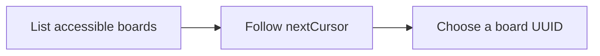

List accessible boards alphabetically. Results are bounded; use returned pagination cursor when present.

## Workflow



## Access and behavior

A Read-only, Write or Administrator OAuth grant can call this tool within the user’s current team role. Tools are listed and callable only when the current grant and role permit them.

Boards sort by case-insensitive name, exact name and UUID. Cursors bind the accessible directory and revision; restart on 409 `board_list_changed`. Historical creators can be null.

## Arguments

| Argument | Required | Type or meaning                                                       |
| -------- | -------- | --------------------------------------------------------------------- |
| `limit`  | No       | integer                                                               |
| `cursor` | No       | Opaque nextCursor from the preceding response with identical filters. |

<Accordion title="Complete input schema">

```json
{
  "type": "object",
  "properties": {
    "limit": {
      "type": "integer",
      "minimum": 1,
      "maximum": 100
    },
    "cursor": {
      "type": "string",
      "maxLength": 2048
    }
  },
  "additionalProperties": false
}
```

</Accordion>

## Example call

The client initializes the MCP connection before sending this JSON-RPC call. Example records are fictional.

```json
{
  "jsonrpc": "2.0",
  "id": 1,
  "method": "tools/call",
  "params": {
    "name": "list_boards",
    "arguments": {
      "limit": 100
    }
  }
}
```

## Example result

Mill returns this object in `structuredContent` and normally a JSON text content block (large responses may shorten the text block). A tool failure sets `isError`; never treat an error as a completed mutation.

```json
{
  "items": [
    {
      "id": "11111111-1111-4111-8111-111111111111",
      "name": "Engineering",
      "prefix": "ENG",
      "description": "Track delivery and reliability.",
      "version": 1,
      "createdBy": {
        "id": "66666666-6666-4666-8666-666666666666",
        "name": "Alex Morgan",
        "email": "alex@example.test",
        "kind": "human"
      },
      "lastActivityAt": "2027-01-18T09:30:00.000Z",
      "backlogCount": 1,
      "todoCount": 1,
      "inProgressCount": 1,
      "activeCount": 2
    }
  ],
  "hasMore": false,
  "nextCursor": null
}
```

## Related reference

[HTTP operation](/api-reference/get_api_boards) · [Connect an MCP client](/mcp-connections) · [Request conventions](/api-reference/overview)
