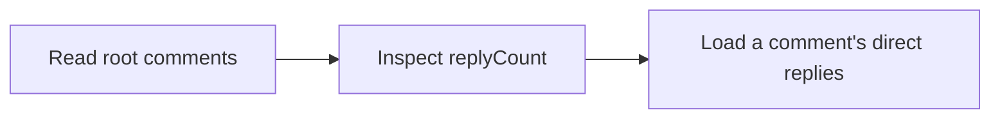

Read comments on a task, newest first. Set `parentId` to root for top-level comments or a comment UUID for its direct replies. Omit it for all comments. Each comment includes `parentId` and `replyCount`; use the cursor within the same thread to load older comments.

## Workflow



## Access and behavior

A Read-only, Write or Administrator OAuth grant can call this tool within the user’s current team role. Tools are listed and callable only when the current grant and role permit them.

Omit `parentId` for a flat list, use root for top-level comments, or a same-task comment UUID for direct replies. Each thread has its own cursor. Replies collapse in the UI; the API returns `parentId` and direct `replyCount`.

## Arguments

| Argument   | Required | Type or meaning                                                                                                                                                      |
| ---------- | -------- | -------------------------------------------------------------------------------------------------------------------------------------------------------------------- |
| `taskId`   | Yes      | Task UUID, not its human identifier such as ENG-1.                                                                                                                   |
| `parentId` | No       | Same-task parent comment UUID. When posting, omit it to create a top-level comment. When listing, use root for top-level comments or omit it to include every level. |
| `limit`    | No       | integer                                                                                                                                                              |
| `cursor`   | No       | Opaque nextCursor from the preceding response with identical filters.                                                                                                |

<Accordion title="Complete input schema">

```json
{
  "type": "object",
  "properties": {
    "taskId": {
      "type": "string",
      "format": "uuid",
      "pattern": "^([0-9a-fA-F]{8}-[0-9a-fA-F]{4}-[1-8][0-9a-fA-F]{3}-[89abAB][0-9a-fA-F]{3}-[0-9a-fA-F]{12}|00000000-0000-0000-0000-000000000000|ffffffff-ffff-ffff-ffff-ffffffffffff)$"
    },
    "parentId": {
      "anyOf": [
        {
          "type": "string",
          "format": "uuid",
          "pattern": "^([0-9a-fA-F]{8}-[0-9a-fA-F]{4}-[1-8][0-9a-fA-F]{3}-[89abAB][0-9a-fA-F]{3}-[0-9a-fA-F]{12}|00000000-0000-0000-0000-000000000000|ffffffff-ffff-ffff-ffff-ffffffffffff)$"
        },
        {
          "type": "string",
          "const": "root"
        }
      ]
    },
    "limit": {
      "type": "integer",
      "minimum": 1,
      "maximum": 100
    },
    "cursor": {
      "type": "string",
      "maxLength": 2048
    }
  },
  "required": ["taskId"],
  "additionalProperties": false
}
```

</Accordion>

## Example call

The client initializes the MCP connection before sending this JSON-RPC call. Example records are fictional.

```json
{
  "jsonrpc": "2.0",
  "id": 1,
  "method": "tools/call",
  "params": {
    "name": "list_comments",
    "arguments": {
      "taskId": "22222222-2222-4222-8222-222222222222",
      "parentId": "root",
      "limit": 50
    }
  }
}
```

## Example result

Mill returns this object in `structuredContent` and normally a JSON text content block (large responses may shorten the text block). A tool failure sets `isError`; never treat an error as a completed mutation.

```json
{
  "items": [
    {
      "id": "33333333-3333-4333-8333-333333333333",
      "taskId": "22222222-2222-4222-8222-222222222222",
      "parentId": null,
      "replyCount": 0,
      "authorId": "66666666-6666-4666-8666-666666666666",
      "authorKind": "human",
      "authorName": "Alex Morgan",
      "body": "The restore check passed.",
      "version": 1,
      "createdAt": "2027-01-18T09:30:00.000Z",
      "updatedAt": "2027-01-18T09:30:00.000Z"
    }
  ],
  "hasMore": false,
  "nextCursor": null
}
```

## Related reference

[HTTP operation](/api-reference/get_api_tasks_by_taskId_comments) · [Connect an MCP client](/mcp-connections) · [Request conventions](/api-reference/overview)
