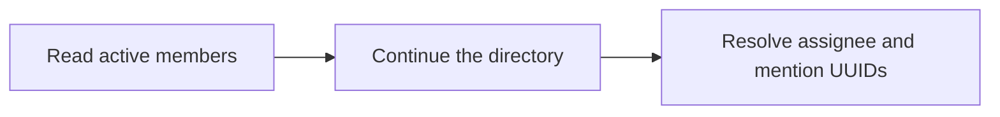

List active workspace members to resolve assignments and mentions. Use `nextCursor` to continue beyond the first page.

## Workflow



## Access and behavior

A Read-only, Write or Administrator OAuth grant can call this tool within the user’s current team role. Tools are listed and callable only when the current grant and role permit them.

Requires workspace-wide read access. A changed directory returns 409 `member_list_changed`; restart without a cursor. Disabled members are not returned.

## Arguments

| Argument | Required | Type or meaning                                                       |
| -------- | -------- | --------------------------------------------------------------------- |
| `limit`  | No       | integer                                                               |
| `cursor` | No       | Opaque nextCursor from the preceding response with identical filters. |

<Accordion title="Complete input schema">

```json
{
  "type": "object",
  "properties": {
    "limit": {
      "type": "integer",
      "minimum": 1,
      "maximum": 1000
    },
    "cursor": {
      "type": "string",
      "maxLength": 1000
    }
  },
  "additionalProperties": false
}
```

</Accordion>

## Example call

The client initializes the MCP connection before sending this JSON-RPC call. Example records are fictional.

```json
{
  "jsonrpc": "2.0",
  "id": 1,
  "method": "tools/call",
  "params": {
    "name": "list_members",
    "arguments": {
      "limit": 1000
    }
  }
}
```

## Example result

Mill returns this object in `structuredContent` and normally a JSON text content block (large responses may shorten the text block). A tool failure sets `isError`; never treat an error as a completed mutation.

```json
{
  "items": [
    {
      "id": "66666666-6666-4666-8666-666666666666",
      "name": "Alex Morgan",
      "email": "alex@example.test",
      "role": "member",
      "timeZone": "UTC",
      "passkeyEnabled": false
    }
  ],
  "hasMore": false,
  "nextCursor": null
}
```

## Related reference

[HTTP operation](/api-reference/get_api_auth_members) · [Connect an MCP client](/mcp-connections) · [Request conventions](/api-reference/overview)
