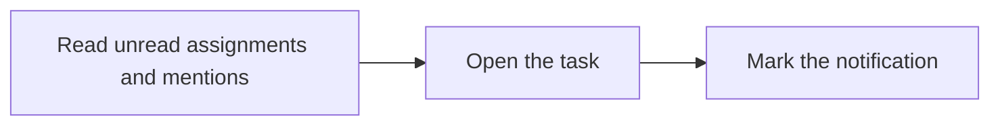

Read every unread assignment and mention notification and notifications read in the last 24 hours. Use `nextCursor` for all pages; `unreadCount` is independent of page size.

## Workflow



## Access and behavior

A Read-only, Write or Administrator OAuth grant can call this tool within the user’s current team role. Tools are listed and callable only when the current grant and role permit them.

Unread notifications remain visible; read notifications are retained in the list for 24 hours. `unreadCount` is independent of page size. These are personal notifications; team API keys cannot access them.

## Arguments

| Argument | Required | Type or meaning                                                       |
| -------- | -------- | --------------------------------------------------------------------- |
| `unread` | No       | boolean                                                               |
| `limit`  | No       | integer                                                               |
| `cursor` | No       | Opaque nextCursor from the preceding response with identical filters. |

<Accordion title="Complete input schema">

```json
{
  "type": "object",
  "properties": {
    "unread": {
      "type": "boolean"
    },
    "limit": {
      "type": "integer",
      "minimum": 1,
      "maximum": 100
    },
    "cursor": {
      "type": "string",
      "maxLength": 2048
    }
  },
  "additionalProperties": false
}
```

</Accordion>

## Example call

The client initializes the MCP connection before sending this JSON-RPC call. Example records are fictional.

```json
{
  "jsonrpc": "2.0",
  "id": 1,
  "method": "tools/call",
  "params": {
    "name": "list_notifications",
    "arguments": {
      "unread": true,
      "limit": 50
    }
  }
}
```

## Example result

Mill returns this object in `structuredContent` and normally a JSON text content block (large responses may shorten the text block). A tool failure sets `isError`; never treat an error as a completed mutation.

```json
{
  "items": [
    {
      "id": "77777777-7777-4777-8777-777777777777",
      "userId": "66666666-6666-4666-8666-666666666666",
      "taskId": "22222222-2222-4222-8222-222222222222",
      "boardId": "11111111-1111-4111-8111-111111111111",
      "kind": "assignment",
      "actorName": "Sam Rivera",
      "identifier": "ENG-1",
      "title": "Verify database restore",
      "readAt": null,
      "createdAt": "2027-01-18T09:30:00.000Z"
    }
  ],
  "hasMore": false,
  "nextCursor": null,
  "unreadCount": 1
}
```

## Related reference

[HTTP operation](/api-reference/get_api_notifications) · [Connect an MCP client](/mcp-connections) · [Request conventions](/api-reference/overview)
